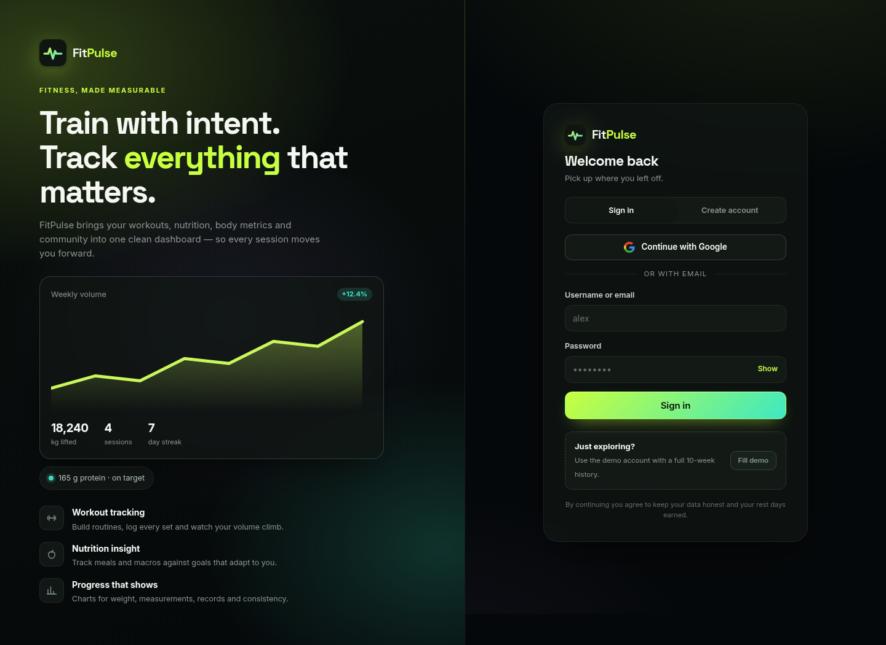
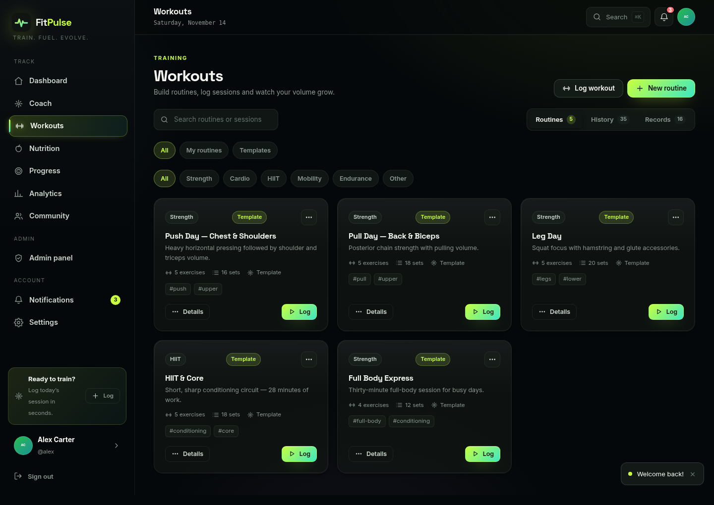
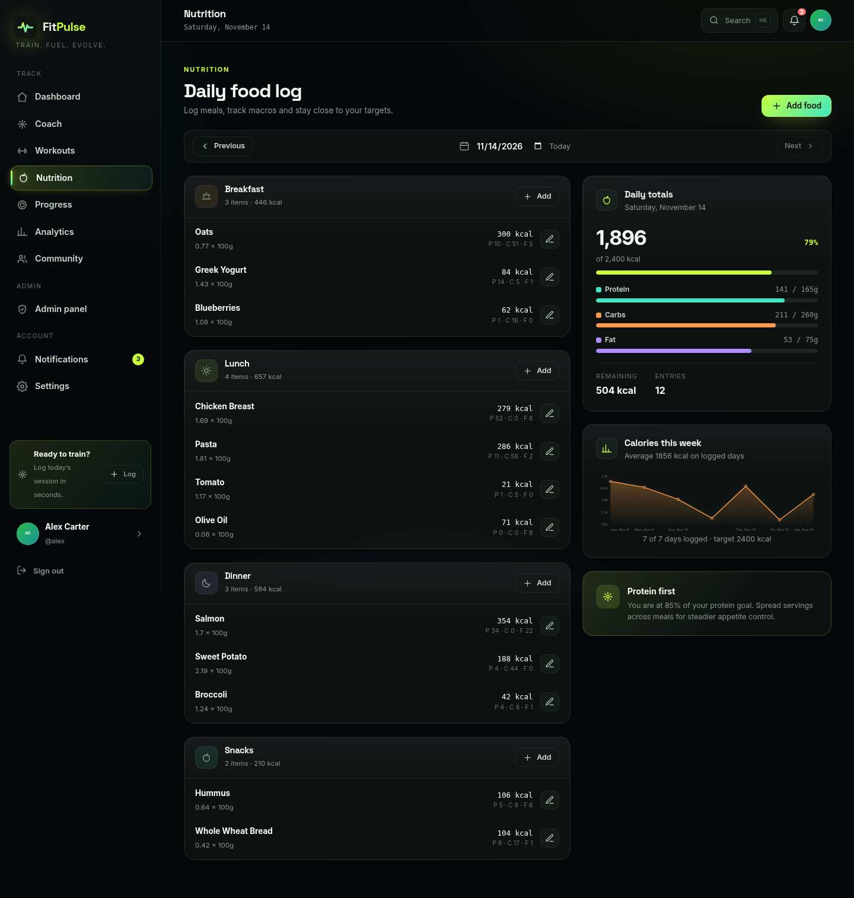
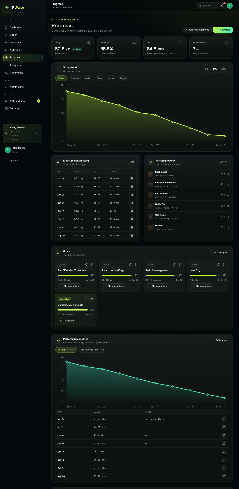
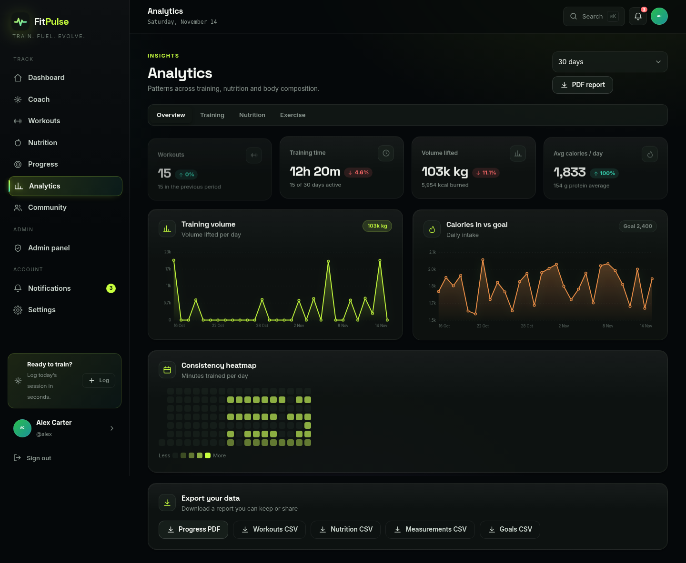
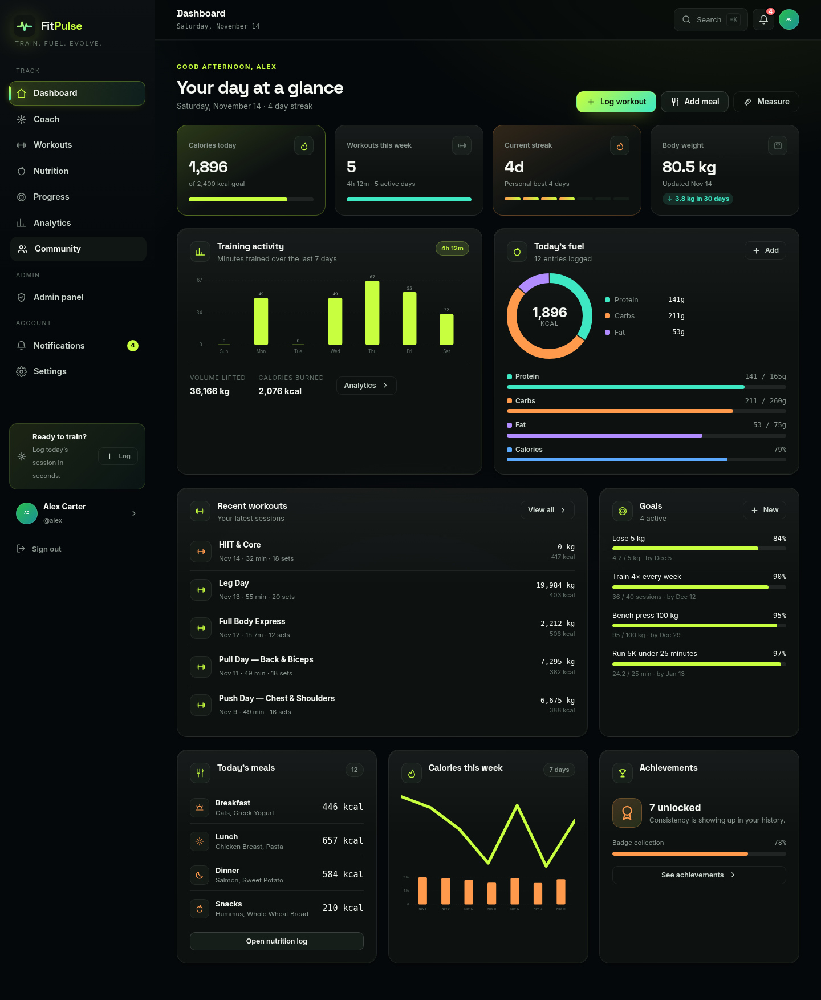
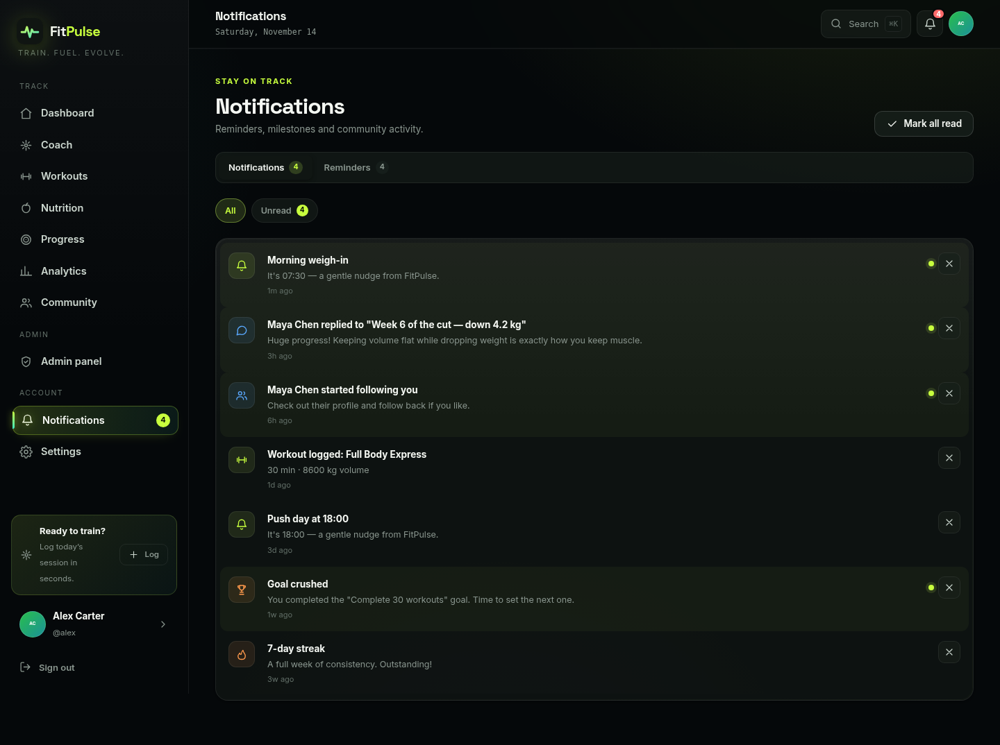
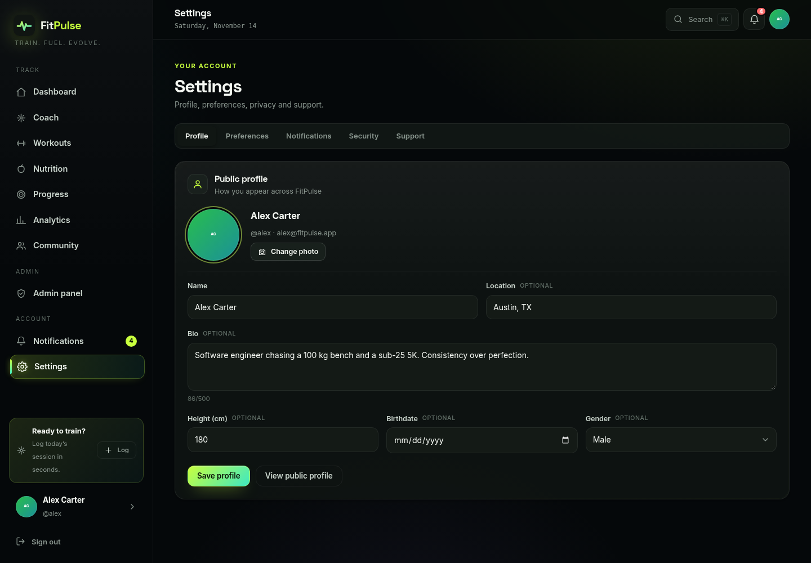
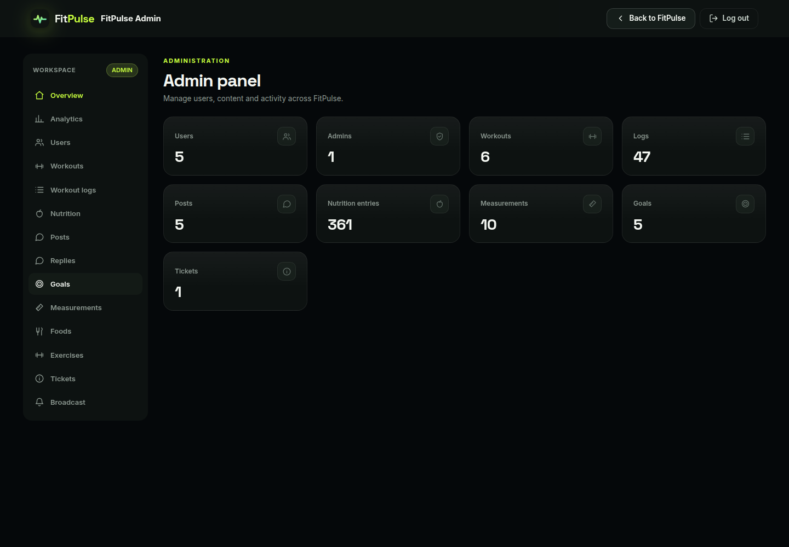

# FitPulse
## User Guide

**Project team**
- Student1602802 — Muhammad Ali Jamal
- Student1406775 — Tayyaba Ajaz
- Student1602810 — Haseeb

**Batch:** 2407G2  
**Instructor:** Sir Muhammad Noman  
**Coordinator:** Miss Urma  
**Application:** https://fitpulse.theali.app

---

## 1. About this guide
This guide explains how to use FitPulse to record workouts, nutrition, body measurements, goals, and community activity. Screens and labels may change slightly as the application is updated. FitPulse is a tracking and organization tool, not a substitute for professional medical or dietary advice.

## 2. Sign in and account access
1. Open [FitPulse](https://fitpulse.theali.app).
2. Choose **Sign in** and enter your username or email plus password, then select **Sign in**. You may alternatively use **Continue with Google** if configured for your account.
3. New users can select **Create account**, provide full name, username, email and a password (at least eight characters, including a letter and a number), then submit.
4. Use **Show** beside the password field to verify what you typed. Use the demo-fill option only for demonstration purposes.
5. After successful authentication, the app opens the Dashboard. Use the profile/settings controls to update account details or sign out.

**Demonstration credentials:** The repository's seeded demo account is username `alex` (email `alex@fitpulse.app`) and password `FitPulse123!`. The seed also defines `maya`, `jordan`, and `priya` with the same demo password. These are public demo credentials, not private personal accounts; confirm that the live deployment has these accounts before a presentation. Alex is seeded as the administrator. Do not include real credentials in screenshots or submitted copies.

## 3. Main navigation and typical journey
A typical user journey is: **Sign in → Dashboard → create/select a workout routine → log a workout → record meals → add measurements and goals → review Progress/Analytics → optionally share in Community**. Notifications and Settings support this journey.

### Dashboard
The Dashboard is the starting summary. Review current activity, recent workout/nutrition information, streaks and goal progress, then use the navigation to open the relevant feature. Demo data may appear for seeded users. Figures are based on records entered in the account and are not medical assessments.

### Workouts
1. Open **Workouts** and browse routines. A routine contains a name, category and exercises, with planned sets, reps, weight, rest and notes where provided.
2. Create a routine using the available create/add action. Give it a name/category and add exercises; set the planned workload and optionally notes/tags.
3. Open a routine to review its exercise plan. Start/log the session and enter completed set details (exercise, set number, reps and weight); add duration, rating or notes if the form offers them.
4. Save the log. The session contributes to workout history, volume, records and analytics. Use duplicate/edit/delete controls carefully; deletion cannot be assumed reversible.
5. Use workout history/logs to review prior sessions and personal records. Record accurate units and values.

### Nutrition
1. Open **Nutrition** and choose the date/day view.
2. Select a meal category (breakfast, lunch, dinner or snack), search the food catalog, choose a food and enter quantity/servings.
3. Save the entry. Calories and macros (protein, carbohydrates and fat) are calculated from the food's nutrition values and quantity.
4. Review daily totals and targets; use favorites/custom foods if available in your account. Correct or remove an entry if quantity or food selection was wrong.
5. Nutrition totals are estimates based on catalog data and serving sizes. Check the serving unit before logging.

### Progress, measurements and goals
1. Open **Progress** and add a dated body measurement (for example weight, body-fat percentage, waist or other supported measurements). Use consistent units and similar conditions for useful comparisons.
2. Add a performance metric where supported (for example a run time or lift record).
3. Create a goal with a title/type, target, unit and optional deadline. Update progress as activity is recorded; some goal progress may update automatically from tracked data.
4. Review progress charts and history to see changes over time. A chart with no data generally means records have not yet been entered for that range.

### Analytics
Open **Analytics** to inspect workout, nutrition and exercise summaries, trends and activity heatmaps. Select a time range when offered. Analytics reflect available records; changing the range changes the data included. Use them to understand consistency and trends, not as clinical advice.

### Community
Open **Community** to view the feed, browse public profiles, follow users and interact with posts. Depending on the screen, you can create a post, select a category, reply and like. Keep personal/health-sensitive information private and review a post before publishing. Profile visibility can be controlled from profile/settings options.

### Notifications and reminders
Use the notification control/bell to review activity notices and mark items read (or use mark-all-read where available). Configure reminders from the relevant reminders/settings interface, selecting a time and days. Notifications can include workout, goal, social and announcement events.

### Profile and Settings
Profile controls let you manage public profile details and supported avatar/bio information. Settings include appearance/theme, unit system, nutrition targets, water/step goals, timezone, week start and notification preferences. Save changes where prompted. Data download and support-ticket options may also be available.

### Reports and exports
Where available, use the report/export controls to download supported CSV datasets or a PDF summary. CSV files are suitable for spreadsheet software. Treat exported files as sensitive because they contain personal activity data; store and share them carefully.

## 4. Administrator access (users should not need this)
An administrator sees an **Admin panel** with a workspace sidebar. It provides overview counts, analytics, user management, workouts, workout logs, nutrition, posts/replies, goals, measurements, food/exercise catalogs, support tickets and broadcast announcements. Admin actions can affect other users. Use them only with authorization. See the separate Developer Guide for implementation/API details. The demo seed sets Alex (`alex` / `FitPulse123!`) as admin, if this demo account is enabled on the live deployment.

## 5. Troubleshooting
- **Sign-in rejected:** check username/email and password, caps lock, and connectivity. Try Google sign-in only if linked/configured.
- **Unexpected empty dashboard/chart:** confirm the date range and that records exist for the signed-in account.
- **Nutrition totals seem wrong:** check serving size, unit and quantity.
- **Page does not respond:** refresh once; if it continues, sign out/in and contact the application administrator with the page and approximate time (never send your password).
- **Admin panel unavailable:** the signed-in account may not have the admin role. Do not attempt to bypass authorization.

## 6. Screenshots
The following screenshots were captured from the live FitPulse website at desktop size (1440 × 1000) using the seeded demo account. Screens show demo information; redact identifiers before sharing outside the project.

### 6.1 Sign in

### 6.2 Dashboard

### 6.3 Workouts

### 6.4 Nutrition

### 6.5 Progress

### 6.6 Analytics

### 6.7 Community
The screenshot below shows the loaded feed with seeded sample posts. Feed loading can take a few seconds on first visit.

### 6.8 Notifications

### 6.9 Settings

### 6.10 Admin panel (reference for authorized admins)

Screenshots show the main feature views. Workout history and records are available from the tabs visible in the Workouts screenshot; select those tabs in the live app to view the corresponding records.

